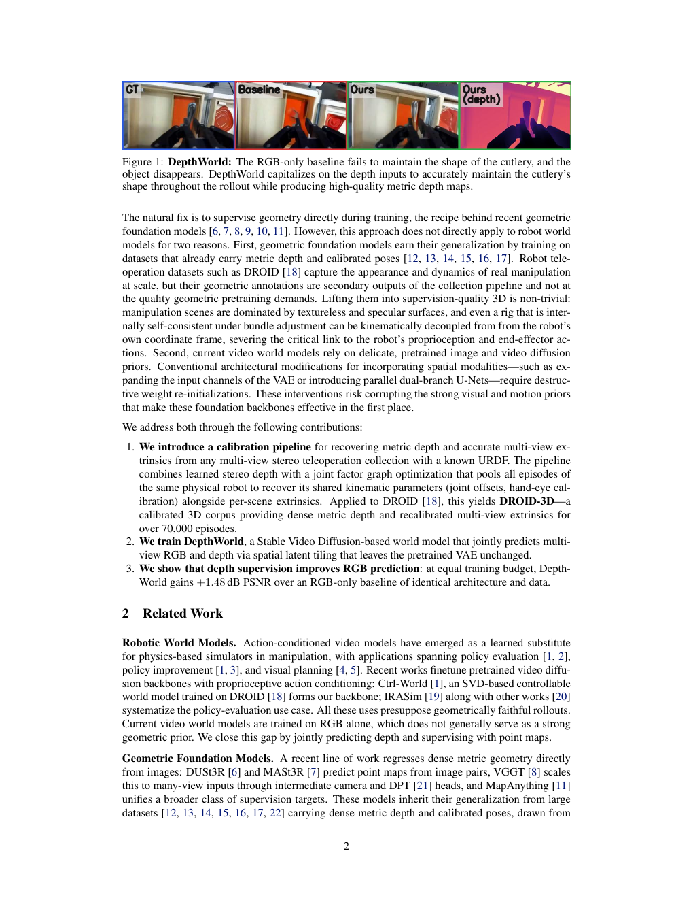
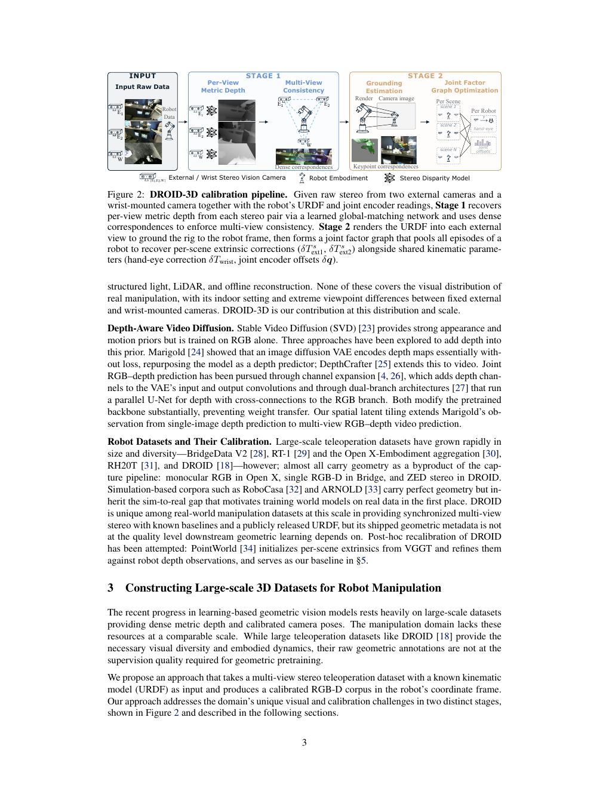
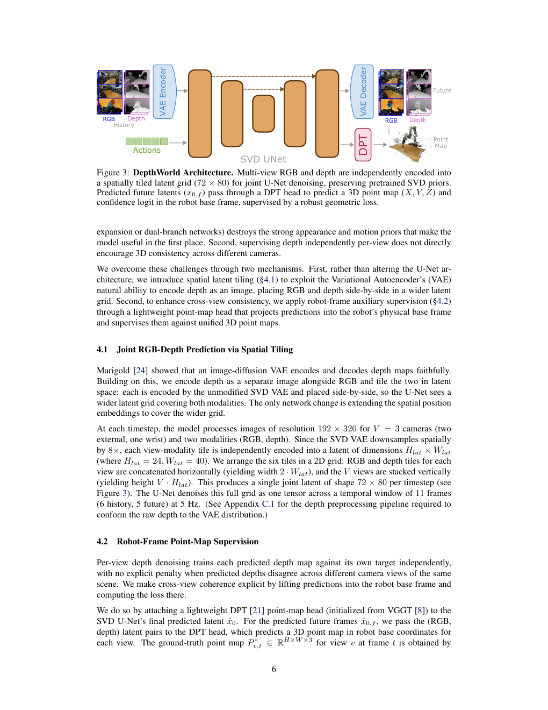
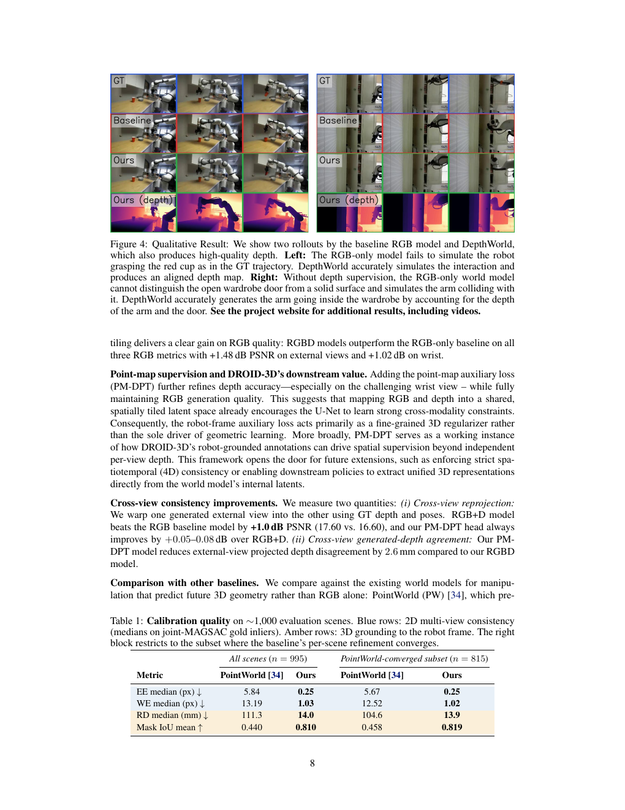
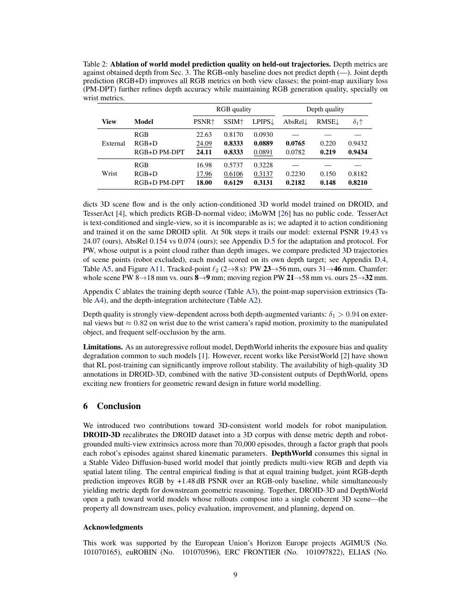

# DepthWorld: 3D World Model for Robot Manipulation

| 字段 | 内容 |
| --- | --- |
| 主题 | 06_机器人操控与世界动作模型 |
| 刊会 | CoRL 2026 |
| 作者 | Jai Bardhan、Josef Šivic、Vladimír Petrík |
| 论文 | [arXiv 2610.08780](https://arxiv.org/abs/2610.08780) |
| 首发日期 | 2026-10-06 |
| 官方项目页 | [DepthWorld](https://jaibardhan.com/depthworld/) |
| 官方代码 | [Jai2500/depthworld](https://github.com/Jai2500/depthworld) |
| 模型权重 | [Hugging Face 模型](https://huggingface.co/jaibrdhn/depthworld) |
| DROID-3D 外参 | [Hugging Face 数据集](https://huggingface.co/datasets/jaibrdhn/droid_3d_extrinsics) |
| 资料核对 | 2026-11-01，原文、官方项目页、官方代码和模型卡 |

## 论文解析

### 一句话结论

DepthWorld 用 DROID-3D 的 metric depth 与机器人坐标系点图监督，在保留 Stable Video Diffusion 预训练 VAE 的前提下联合预测多视角 RGB 和 depth；这使 rollout 更有几何一致性，但论文主要证明了更可靠的 3D 世界模型表征，还没有完整证明独立 latent planner 的闭环成功率。

### 研究问题

RGB-only 视频世界模型可能逐帧看起来合理，却无法保持物体形状、跨视角深度、遮挡关系和机器人接触几何。这样的 rollout 对 policy evaluation、policy improvement 和 planning 都不够可靠。

论文解决两个问题：

1. DROID 的几何标注如何变成适合机器人 3D 学习的 DROID-3D；
2. 如何给 SVD 视频模型加入 depth 和点图监督，而不破坏预训练的视频先验。

**专业解释：** RGB-only baseline 在 rollout 中逐渐失去餐具和物体形状；DepthWorld 利用 depth 条件维持更稳定的三维结构。

**通俗解释：** 单看颜色，模型可能生成“像是抓住了东西”的画面，但物体会慢慢变形或消失；深度提供了额外的空间约束。

### DROID-3D 数据管线

DROID-3D 先用已知 stereo baseline、焦距和 disparity 恢复 metric depth：

$$
z(u)=\frac{f b}{d(u)}.
$$

随后使用跨视角匹配和 bundle adjustment 保证多视角一致，再用 URDF 渲染、机器人关节读数和跨 episode factor graph 把相机 rig 锚定到 robot base frame。最终覆盖约 71,100 个 scene、28 台机器人和 13 个实验室。

跨 episode 联合优化的关键是把每个 scene 的临时外参误差，与同一台机器人共享的 hand-eye 修正和 joint encoder offsets 分离开。

**专业解释：** Stage 1 先恢复每个视角的 metric depth 并做多视角一致性；Stage 2 用 URDF 和机器人坐标约束，把相机外参与共享运动学参数放进联合 factor graph。

**通俗解释：** 先让不同摄像头看到同一个三维世界，再让这个世界和机器人本体对齐；这样模型输出的三维点才有可用于规划的物理坐标。

### DepthWorld 模型

DepthWorld 以 Stable Video Diffusion/Ctrl-World 为基础，使用 spatial latent tiling：

- 两个 external camera 和一个 wrist camera；
- 每个视角有 RGB 与 depth 两种模态；
- 原图为 192×320，SVD VAE 下采样后每个 tile 为 24×40；
- RGB-depth 沿宽度拼接，三个视角沿高度堆叠，得到 72×80 joint latent；
- 单个窗口含 6 帧历史和 5 帧未来，采样频率 5 Hz；
- action conditioning 采用逐帧 7 维末端执行器动作。

预训练 VAE 不改通道；模型只需把 spatial position embedding 扩展到更宽的 latent grid。

**专业解释：** RGB 和 depth 经未修改 VAE 编码后在空间 latent grid 中联合去噪；未来 latent 通过 VAE 解码出 RGB/depth，并经 DPT head 预测 robot-frame XYZ 与 confidence。

**通俗解释：** RGB 和深度被放进同一张“潜空间地图”中共同预测，而不是各自独立猜测；额外的点图头检查三维坐标是否一致。

### 训练目标

论文的联合目标为：

$$
\mathcal L
=
\mathcal L_{\mathrm{denoise}}
+
\lambda_{\mathrm{pm}}\mathcal L_{\mathrm{pm}}.
$$

L denoise 训练未来 RGB-depth latent 的扩散去噪，L pm 训练机器人坐标系中的 point map，第二阶段使用 λ pm=0.005。

训练分两阶段：

1. 40,000 steps：只学习联合 RGB-depth latent 分布；
2. 50,000 steps：加载 VGGT 初始化的 DPT head，联合训练点图监督。

点图头输出 X、Y、Z 和 confidence logit，使用 confidence-weighted robust loss。它不是简单地对每个摄像头独立预测深度，而是要求不同视角的预测在同一 robot base frame 中一致。

### 实验设置

世界模型评估使用 256 条 held-out DROID trajectories，并连续 autoregressive rollout 10 个 chunk。比较：

- RGB：RGB-only Ctrl-World baseline；
- RGB+D：联合 RGB-depth；
- RGB+D PM-DPT：再加入 robot-frame point-map head。

报告 RGB 的 PSNR、SSIM、LPIPS，depth 的 AbsRel、RMSE、δ1，并分别统计 external 和 wrist view。

### 主要结果

| View | Model | PSNR | SSIM | LPIPS | AbsRel | RMSE | δ1 |
| --- | --- | ---: | ---: | ---: | ---: | ---: | ---: |
| External | RGB | 22.63 | 0.8170 | 0.0930 | - | - | - |
| External | RGB+D | 24.09 | 0.8333 | 0.0889 | 0.0765 | 0.220 | 0.9432 |
| External | RGB+D PM-DPT | 24.11 | 0.8333 | 0.0891 | 0.0782 | 0.219 | 0.9434 |
| Wrist | RGB | 16.98 | 0.5737 | 0.3228 | - | - | - |
| Wrist | RGB+D | 17.96 | 0.6106 | 0.3137 | 0.2230 | 0.150 | 0.8182 |
| Wrist | RGB+D PM-DPT | 18.00 | 0.6129 | 0.3131 | 0.2182 | 0.148 | 0.8210 |

作者项目页将代表性 RGB 增益总结为 external +1.48 dB、wrist +1.02 dB；论文 Table 2 的具体四舍五入数值分别为 +1.46 dB 和 +0.98 dB。本文以 Table 2 为主要证据。

**专业解释：** RGB-only baseline 在抓杯子和打开柜门的 rollout 中逐渐失去形状或误判门的深度；DepthWorld 产生 RGB、depth 和更合理的空间关系。下方 Table 1 显示 DROID-3D 校准在 reprojection、robot depth 和 Mask IoU 上明显优于 PointWorld-style baseline。

**通俗解释：** 颜色看起来像真的，不代表物体在三维空间的位置是对的。DepthWorld 让模型更难“把柜门当成一堵实心墙”。

### 校准定量结果

| 指标 | PointWorld-style baseline | DROID-3D |
| --- | ---: | ---: |
| EE median reprojection（px） | 5.84 | 0.25 |
| WE median reprojection（px） | 13.19 | 1.03 |
| Robot depth median（mm） | 111.3 | 14.0 |
| Mask IoU mean | 0.440 | 0.810 |

实验室 GT setup 中，作者报告外参约 4.9 mm/0.39°、hand-eye 约 3 mm/0.3°，joint offsets 平均误差约 0.14°。

**专业解释：** RGB+D 已经改善 RGB 和 depth；PM-DPT 进一步细化 depth，尤其是 wrist view，同时基本保持 RGB 质量。

**通俗解释：** 深度不是只增加一个输出，而是给模型提供额外的空间约束，反过来帮助 RGB rollout 更稳定。

### 与潜空间规划的关系

DepthWorld 的 RGB-depth 在 latent grid 中联合预测，因此可以作为 geometry-aware latent planner 的预测器。一个可能的后续目标是：

$$
J(a)
=
\sum_{\tau=1}^{H}
\left[
\alpha d_{\mathrm{goal}}(\hat P_\tau,P_g)
+
\beta d_{\mathrm{collision}}(\hat P_\tau)
\right],
$$

其中 P 是预测的机器人坐标系 point map。这个规划接口是本文分析，不是论文已经报告的最终规划结果。

论文没有报告完整的 CEM/MPC 成功率，因此不能把更好的 PSNR、depth 或 Chamfer 自动写成更好的控制性能。这是本论文最重要的证据边界。

### 与相关方法的关系

- PointWorld：在共享 3D 空间预测 point flows，强调 action/state 的几何统一；
- TesserAct：预测 RGB-D-normal 的 4D embodied world model，但原始设置不是本论文的 action-conditioned multi-view protocol；
- RoboJEPA：在视觉 latent 中做动作条件预测和 latent planning scaling；
- DepthWorld：以视频扩散为 backbone，联合生成 RGB-depth，并用 robot-frame point map 增强几何一致性。

### 优势

- 同时解决数据标定和模型融合问题；
- 尽量不破坏 SVD 预训练先验；
- 提供多视角、depth、point map 与 robot frame 的几何证据；
- 开放代码、模型 checkpoint 和训练/评测脚本。

### 局限

1. 主要结果是世界模型预测质量，不是完整闭环规划成功率；
2. 依赖 stereo、多视角、URDF 与机器人关节读数；
3. 主要数据分布为 Franka 操控；
4. SVD VAE 对 depth 有表示误差下限；
5. autoregressive rollout 仍会有 exposure bias 和长时域退化；
6. 几何指标改善不自动等于动作排序、碰撞判断和真实任务成功率改善。

### 可复现性

官方仓库提供 SVD/CLIP/VGGT 依赖、训练脚本、单 chunk 评测、autoregressive rollout 评测以及点云可视化。公开 checkpoint 为 90k-step EMA 权重；原始 DPT warm-start 的 40k 权重未发布，因此直接从公开 90k checkpoint 继续训练不等价于论文的原始训练 schedule。DROID-3D 深度和校准文件需要按官方说明申请访问。

### 研究问题

1. 能否用 point-map latent 训练 geometry-aware critic，直接与 CEM/MPC 对接？
2. 能否把 dense point map 压缩为物体、接触和 affordance token，减少 VAE depth floor？
3. 能否用 4D cycle consistency 降低多视角和长 rollout drift？
4. 能否由 point map 自动生成可达的 3D subgoal，扩大 latent planning range？
5. 能否在真实机器人上用碰撞率、成功率和几何误差联合评估世界模型？

### 理解与讨论

1. 为什么 RGB-only rollout 看起来正确，仍然可能无法用于规划？
2. 为什么 robot-frame point-map supervision 比每个视角独立预测 depth 更强？
3. 为什么 DepthWorld 的 RGB 指标提升仍不能直接证明 latent-space planning 成功率提升？

## 证据与来源

- 原文：[arXiv 2610.08780](https://arxiv.org/abs/2610.08780)
- 官方项目页：[DepthWorld](https://jaibardhan.com/depthworld/)
- 官方代码：[Jai2500/depthworld](https://github.com/Jai2500/depthworld)
- 模型卡：[jaibrdhn/depthworld](https://huggingface.co/jaibrdhn/depthworld)
- DROID-3D 数据入口：[jaibrdhn/droid_3d_extrinsics](https://huggingface.co/datasets/jaibrdhn/droid_3d_extrinsics)

论文、图示和数值均以本次核验的 arXiv 版本及官方页面为准。本文的规划接口、自动子目标和 geometry-aware critic 属于分析与后续研究建议，不是论文已完成的实验。
